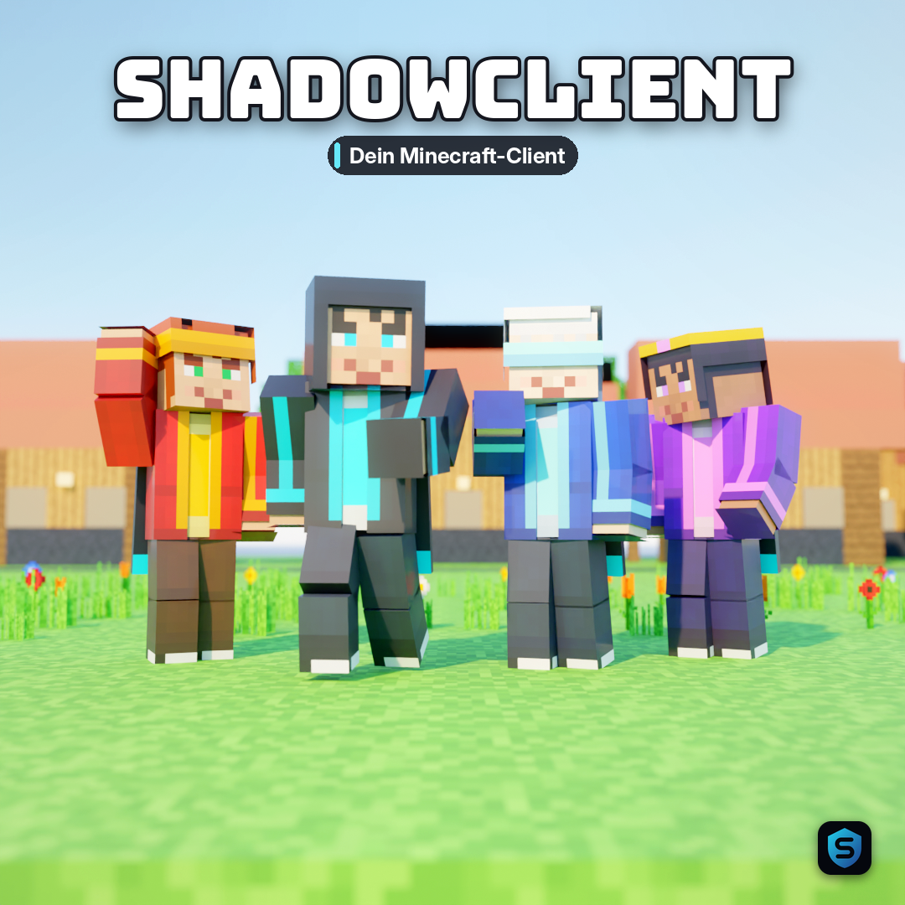
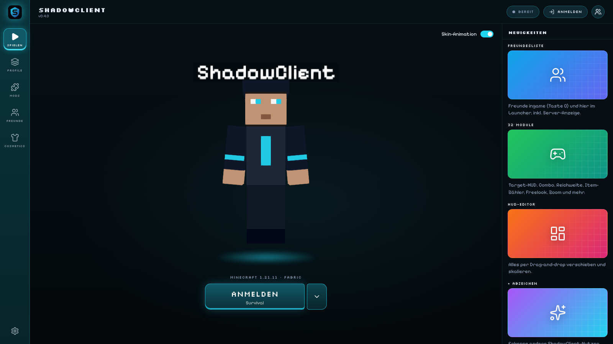
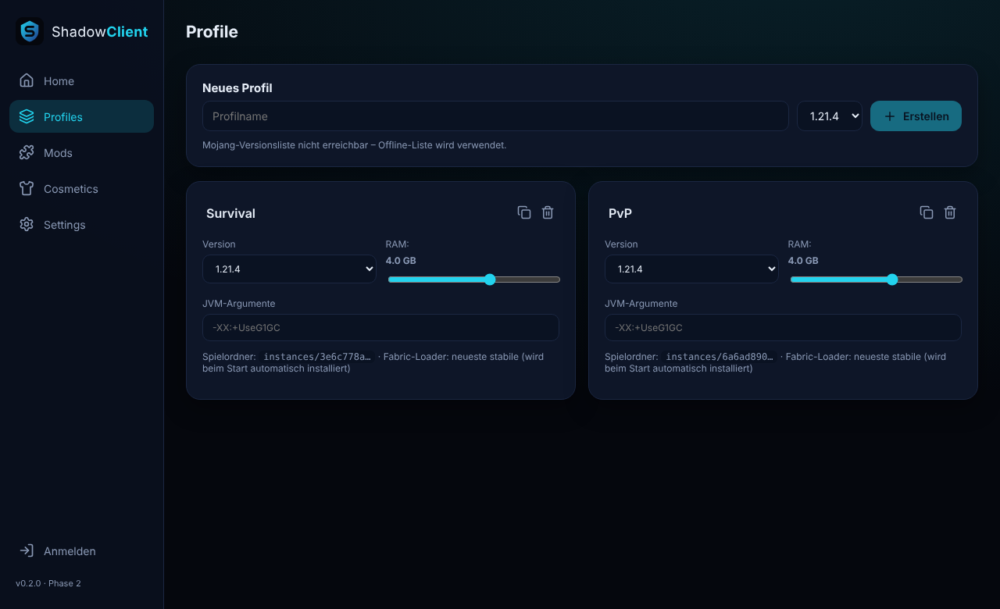
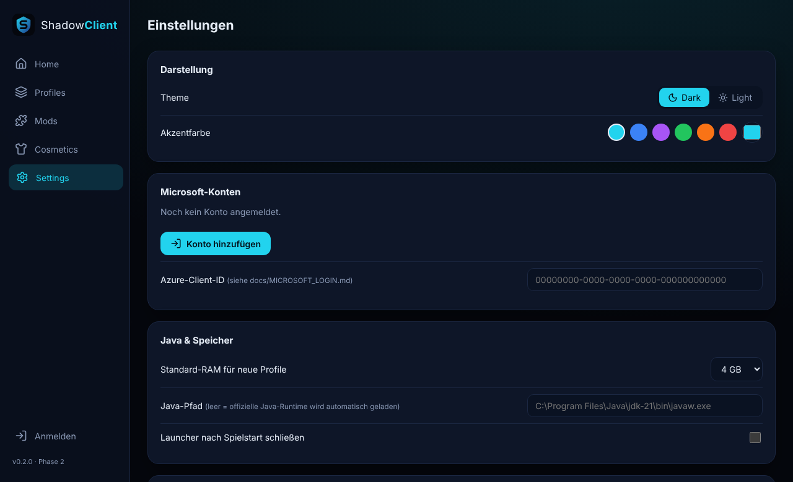
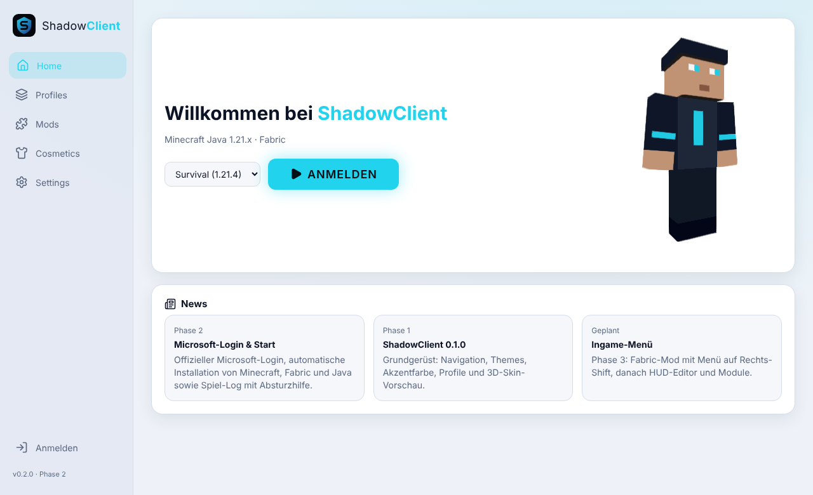

<p align="center">
  
</p>

<h1 align="center">ShadowClient</h1>
<p align="center">A modern, open-source launcher and client for <b>Minecraft: Java Edition 1.21.x</b> with Fabric.</p>

<p align="center">
  
  
</p>

> **Not affiliated with Mojang or Microsoft.** ShadowClient is an independent project.
> Players need their own Microsoft account that owns Minecraft: Java Edition.

## Features

**Launcher** (Tauri 2 · Rust · React · TypeScript)
- Sign in with Microsoft using the official **OAuth 2.0 device code flow**. Passwords are never seen or stored.
- Refresh tokens are stored only in the **Windows Credential Manager**. Access tokens stay in memory and are masked in logs.
- Ownership check via the official Minecraft profile API
- Automatic installation of Minecraft, Fabric Loader and the official Java runtime, all from official sources with SHA-1 verification
- Multiple profiles, each with its own game folder, mods, RAM and JVM settings
- Live game log with readable crash explanations
- Dark/light theme, custom accent color, 3D skin preview

**In-game client** (Fabric mod for 1.21.4)
- Modular menu (Right Shift), drag-and-drop HUD editor, FPS / ping / CPS / coordinates / keystrokes, custom crosshair
- Client-side visuals only. **No server manipulation, no anti-cheat bypasses.**

## Screenshots

| Profiles | Settings | Light mode |
|---|---|---|
|  |  |  |

## Authentication flow

```
Microsoft (device code, scope: XboxLive.signin offline_access)
  → Xbox Live → XSTS → api.minecraftservices.com (login_with_xbox)
  → /minecraft/profile (ownership + skin) → launch
```

Implementation: [`launcher/src-tauri/src/auth.rs`](launcher/src-tauri/src/auth.rs) · Privacy: [PRIVACY.md](PRIVACY.md)

## Project structure

| Folder | Content | Status |
|---|---|---|
| `launcher/` | Desktop app (Tauri 2, React, Rust) | ✅ |
| `shared/` | Shared data models (TypeScript + JSON Schema) | ✅ |
| `minecraft-mod/` | Fabric mod (in-game menu, HUD modules) | ✅ Phase 3 |
| `backend/` | Optional online features (opt-in cosmetics sync) | 🚧 Phase 6 |
| `docs/` | Installation and developer docs | ✅ |

## Build (Windows 10/11)

Requirements: Node.js 20+, Rust (stable, MSVC), WebView2.

```bash
cd launcher
npm install
npm run tauri dev      # development
npm run tauri build    # installer (.exe / .msi)
```

Tests: `npm run build` (type check) and `cd src-tauri && cargo test`.
More: [docs/INSTALL.md](docs/INSTALL.md) · [docs/ARCHITECTURE.md](docs/ARCHITECTURE.md) · [docs/ROADMAP.md](docs/ROADMAP.md)

---

### 🇩🇪 Kurzbeschreibung
ShadowClient ist ein Open-Source-Launcher mit Fabric-Client für Minecraft Java 1.21.x. Die Anmeldung läuft über den offiziellen Microsoft-Login, Passwörter werden nie gespeichert. Anleitung: [docs/INSTALL.md](docs/INSTALL.md).

## License
[MIT](LICENSE). Minecraft is a trademark of Mojang AB. This project uses no Mojang assets; game files are downloaded from official servers at runtime.
